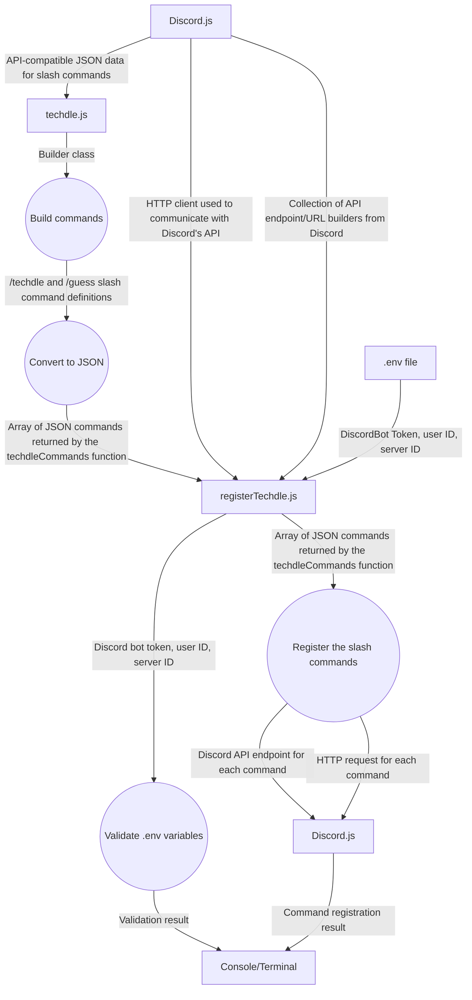

# Techdle Diagram

This diagram shows how our Techdle bot uses `/techdle` and `/guess` commands to saved game files.

# Aythan - Data Flow
This diagram shows the dataflows between Discord's API and our bot.

# Anthony - Network Diagram

# Mario - Control Flow

# Sida - Class Diagram

# Abhi - Use Case Diagram

Each player has one current game. Starting `/techdle` again replaces that player's game. Guesses must be five letters and any five-letter guess is scored without checking a word list. Invalid guesses use no attempts.

**Code:** `src/events/interactionCreate.js` handles commands and replies; `src/game/` contains the rules and feedback; `src/game/store.js` saves games; and `src/game/words.js` provides tech answers.
