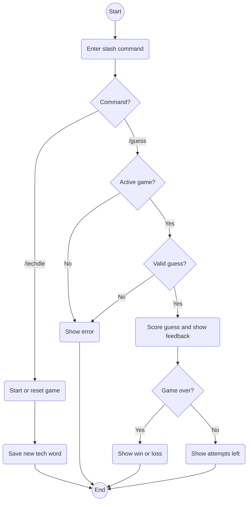

# Techdle Diagram

This diagram shows how our Techdle bot uses `/techdle` and `/guess` commands to saved game files.

# Aythan - Data Flow

# Anthony - Network Diagram

# Mario - Control Flow

# Sida - Class Diagram

# Abhi - Use Case and Activity Diagram

The use case diagram below shows how a player interacts with TechdleBot through its two slash commands. Players can start or reset a game with `/techdle` and submit guesses with `/guess`. A game must be started before a player can submit a guess.

```mermaid
usecase-beta
direction TB

actor Player

systemBoundary "TechdleBot"
  StartGame("Start or reset game with /techdle")
  SubmitGuess("Submit a five-letter guess with /guess")
end

Player --> StartGame
Player --> SubmitGuess
```

The activity diagram shows how TechdleBot handles its two slash commands. The `/techdle` command starts a new game or resets an existing one with a new word. The `/guess` command checks whether the player has an active game and submitted a valid five-letter guess. The bot then provides feedback and either displays the remaining attempts or ends the game with a win or loss.




Each player has one current game. Starting `/techdle` again replaces that player's game. Guesses must be five letters and any five-letter guess is scored without checking a word list. Invalid guesses use no attempts.

**Code:** `src/events/interactionCreate.js` handles commands and replies; `src/game/` contains the rules and feedback; `src/game/store.js` saves games; and `src/game/words.js` provides tech answers.
